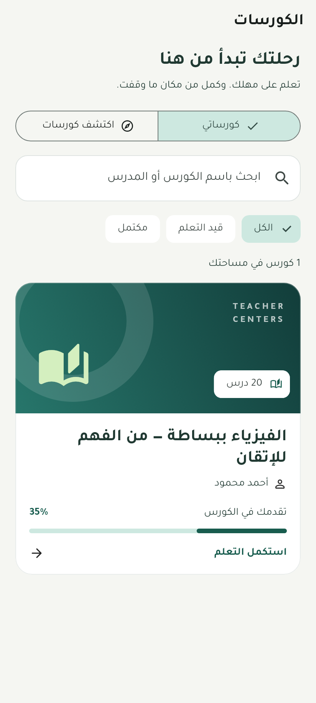
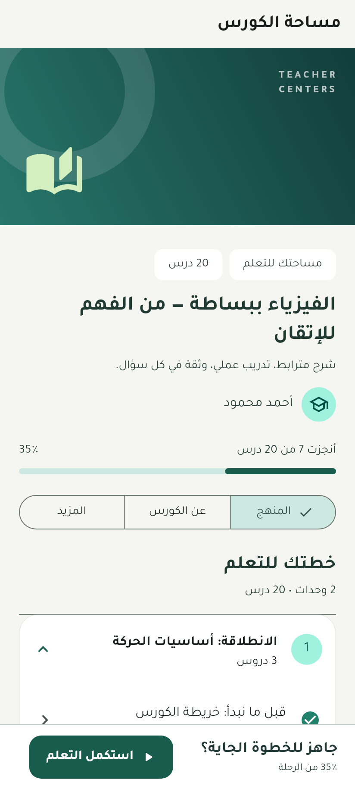

# رواق — Rewaq

تطبيق Flutter عربي للمدرس والطالب، مبني على عقود الباك إند الحالية في
`AmirDarwiish/TeacherCenters` عند commit `cd475d3dbaac0dd6fb48522174ecaa80d10d70b1`.
لا يحتوي هذا المشروع على تغييرات للباك إند أو بيانات دخول أو مفاتيح دفع.

## تحديث 1.2 — التعلم والدخول والرئيسية

- اختيار دور واحد في الدخول، واختيار السنتر بعد OTP عند نشر إضافة الباك إند.
- تفاصيل حصة كاملة بالمعلومات المتاحة وحفظ حالة تبويبات التنقل.
- مستحقات تفصيلية مع سداد البنود المحددة ومتابعة الدفع عند الرجوع من البوابة.
- دخول الطالب وولي الأمر بدون حقل كود سنتر في النسخة المخصصة؛ OTP بست خانات مع اللصق والأرقام العربية والتعبئة التلقائية.
- متابعة ولي الأمر لأبنائه بمساحة قراءة منفصلة عن إجراءات الطالب.
- الرئيسية تضع استكمال التعلم والحصة القادمة قبل الإجراءات الثانوية.
- نظام بصري موحد بألوان دلالية، خط عربي، ووضعين فاتح وداكن.
- مكتبة الطالب والكتالوج مع البحث والفلاتر وحالات النتائج الفارغة.
- تفاصيل الكورس: المنهج والأهداف والمتطلبات والجمهور ومدة الوصول والتقدم.
- استكمال آخر درس متاح، ومعاينة المحتوى، وفصل المشترك عن المشتري، واشتراك مجاني مباشر.
- مساحة درس محسّنة، ملفات، تفاصيل المحاولات، سرعة الفيديو وملء الشاشة وتحديث الرابط عند الخطأ.
- إعدادات الكورس، رفع الغلاف، تنظيم المنهج، تعديل الدروس والمعاينة ومدة الفيديو.
- تحرير الكورس يحافظ على مجموعاته وإعداداته ويستخدم رقم النسخة عند توفره.

صور الواجهات تستخدم بيانات اختبار معلنة، وليست سجلات طلاب حقيقية:

| مكتبة الطالب | مساحة الكورس |
| --- | --- |
|  |  |

## التشغيل

Flutter **3.47.7** / Dart **3.13.5**، Java 17 لبناء Android، وXcode لبناء iOS.

```bash
flutter pub get
flutter run --dart-define=TENANT_SLUG=teachercenter-demo
```

السيرفر الافتراضي `https://teachercenter.runasp.net/api/v1` ويمكن تغييره وقت البناء:

```bash
flutter run --dart-define=API_BASE_URL=https://your-host/api/v1 --dart-define=TENANT_SLUG=your-center
```

السنتر يمرر كإعداد للبناء. الطالب وولي الأمر لا يُطلب منهما كتابة كود؛ المدرس يستطيع تغيير جهة الدخول. لا يتم اختيار سنتر
من رقم الموبايل تلقائياً. OTP يأتي من إعدادات السيرفر؛ لا يوجد رمز ثابت في التطبيق.

## الوظائف الحالية

### الطالب

- دخول بالموبايل وOTP واختيار الطالب بعد التحقق لو الرقم مشترك.
- ملخص الحضور والدرجات والمستحقات والحصة القادمة.
- الكورسات، الكتالوج، الأقسام، الدروس النصية، وفتح الملفات الموقعة.
- تشغيل MP4/HLS داخل التطبيق، الاستكمال من موضع الكورس، وحفظ التقدم كل 15 ثانية.
- روابط YouTube/Vimeo تفتح في التطبيق الخارجي؛ لا يدعي التطبيق إكمال مشاهدة خارجية.
- امتحانات الكورسات: اختيار واحد، متعدد، صح وخطأ، إكمال، مقالي، شرح، إجابة قصيرة، توصيل، وترتيب.
- امتحانات المجموعات القديمة لها مسارها وعقد الإجابة المنفصل.
- حفظ الإجابات واستكمال المحاولة والمهلة والتسليم والنتيجة حسب سياسة السيرفر.
- الواجبات النصية، التسليم والتعديل قبل الإغلاق، وقراءة الدرجات والتعليقات.
- جدول الحصص والحضور والدرجات المنشورة وبطاقة QR الخاصة بالطالب.
- المستحقات وسجل الدفع، واختيار طريقة متاحة وفتح صفحة الدفع، ثم تحديث الحالة من السيرفر.
- أهلية شهادة الكورس وإصدارها وقراءة بياناتها.
- فتح محادثة من الكورس والرسائل والإشعارات.

### المدرس

- ملخص اليوم، مجموعاته وطلابها وسجل الحضور والدرجات لكل طالب.
- الحصص مع فلتر الفترة والمجموعة، وإنشاء حصة.
- كشف الطلاب المنتظرين وتسجيل حاضر/متأخر/غائب/بعذر، ثم تحديث القائمة وإغلاق الحصة.
- الكورسات ومسودات كورسات عامة جديدة، الأقسام، والدروس النصية/الملفات/الفيديو والنشر.
- إنشاء امتحان كورس من بنك الأسئلة الموجود، متابعة النتائج، وتصحيح المقالي والشرح.
- رفع ملفات الدروس وفيديوهات مجزأة 4 MiB مع إعادة محاولة الأجزاء المتطابقة.
- إدخال مدة الفيديو عند الرفع لضمان توفر مدة معلومة لحساب الإكمال.
- تقدم الطلاب ومتوسط الاختبارات، وتسليمات الواجبات وتصحيحها.
- الرد على المحادثات والإشعارات.

### مشترك

- RTL وخطوط Alexandria وIBM Plex Sans Arabic مضمّن بدون تنزيل خطوط عند التشغيل؛ وضع فاتح وداكن.
- حفظ جلسة واحدة في Secure Storage وتجديد دوّار متزامن مرة واحدة، ومسح التنقل الخاص عند الخروج.
- أخطاء الأعمال العربية من السيرفر، قوائم بصفحات، إعادة محاولة وتحديث بالسحب.
- اتصال SignalR واحد أثناء وجود التطبيق بالمقدمة، وإعادة الاشتراك وتحديث REST بعد الاتصال.
- توقف الاتصال وتشغيل الفيديو عند مغادرة التطبيق؛ لا توجد خدمة خلفية تستهلك الشبكة.

## التحقق وحدود الجاهزية

التحقق الآلي يشمل تحليل Flutter، اختبارات الجلسات والدخول، والبحث والاستكمال والاشتراك
المجاني وحفظ ترتيب المنهج والحفاظ على المجموعات عند التعديل. اختبارات الواجهات تستخدم
API مزيفاً، وتشمل العربية وRTL والوضع الداكن وعرض 360px وتكبير النص 1.3.
لإعادة إنتاج صور الواجهات:

```bash
flutter test --dart-define=SCREENSHOTS=true test/course_experience_test.dart
```

الربط الحي يحتاج حساب طالب ومدرس مخصصين للاختبار على السيرفر المنشور، مع اختبار
OTP والدفع والفيديو والصلاحيات على جهاز Android فعلي. لا توجد نتائج نجاح محلية بديلة لفشل السيرفر.

باقي للتغطية الكاملة: مسح QR بالكاميرا، تأليف بنك أسئلة جديد، إنشاء الواجبات
وامتحانات المجموعات، المواعيد الدورية، إدارة منح الكورسات، العلامة الشخصية للمدرس،
تصدير الشهادة كملف، إشعارات Push، واستكمال رفع الفيديو بعد إغلاق التطبيق.
بعض هذه العمليات متاح في الباك إند ولم تكتمل واجهته على الموبايل.

GitHub Actions يبني APK محسّناً بوضع release للتجربة. توقيعه تجريبي؛ نشر المتاجر
والتحديثات الدائمة يحتاجان مفتاح توقيع إنتاج محفوظاً خارج الريبو ومعرفات التطبيق النهائية.
ليس هذا إعلان جاهزية إنتاج أو بديلاً لاختبار قبول واقعي.

## تنزيل نسخة Android للتجربة

كل `push` وأي Pull Request يشغّل workflow **Rewaq Android APK** تلقائيًا.
بعد نجاح التنسيق والتحليل والاختبارات والبناء:

1. افتح [GitHub Actions](https://github.com/AmirDarwiish/TeacherCenters-Mobile/actions/workflows/flutter.yml).
2. اختار آخر تشغيل ناجح على الفرع المطلوب.
3. اضغط **تحميل APK** في ملخص التشغيل، أو نزّل `rewaq-apk-رقم التشغيل` من **Artifacts**.
4. فك ضغط الملف وثبّت `rewaq-الإصدار-الكوميت.apk` على الموبايل.

التحميل يحتاج تسجيل الدخول إلى GitHub وصلاحية الوصول للريبو. النسخ محفوظة لمدة ٣٠ يومًا،
ومع كل APK ملف SHA-256 للتحقق من سلامته. تقدر تعيد البناء من **Run workflow**.
تحديث الفرع أثناء بناء قديم يلغي البناء القديم ويبدأ نسخة بالتعديلات الأحدث.

السنتر الافتراضي `teachercenter-demo`. لتغييره للبناء التلقائي، اضبط repository variable
باسم `TENANT_SLUG` من **Settings → Secrets and variables → Actions → Variables**.
نسخ التجربة تستخدم توقيع debug الخاص ببيئة البناء؛ التحديث المستمر فوق نسخة مثبتة يحتاج مفتاح توقيع ثابت.

## الفحص والبناء

```bash
dart format --output=none --set-exit-if-changed lib test
flutter analyze
flutter test
flutter build apk --release --dart-define=TENANT_SLUG=teachercenter-demo
flutter build web --dart-define=TENANT_SLUG=teachercenter-demo
flutter build ios --no-codesign --dart-define=TENANT_SLUG=teachercenter-demo
```

الفيديو والملفات تظل خاصة وفق صلاحية السيرفر وروابطه الموقعة. لا نسخ كاملة للفيديو
في الذاكرة، ولا قواعد بيانات وهمية أو نتائج نجاح بديلة عند فشل API.


## الحضور والحصص الحالية

- زر «سجّل حضوري للحصة الحالية» يحدّث حصص الطالب ويفتح تسجيل الموقع والصورة للحصة الجارية؛ لو فيه حصتين متزامنتين تختار الحصة المطلوبة.
- الحصة الجارية تظهر أولًا، ثم القادمة الأقرب، ثم السابقة من الأحدث. تُحمّل صفحات حصص الطالب قبل الترتيب.
- كارت الحصة في الرئيسية يفتح التفاصيل، وتتحدث حالة الحضور بعد العودة أو وصول إشعار تغيير.
- نافذة التسجيل وإعدادات الفرع والقرار النهائي من السيرفر. سبب المنع يظهر بوضوح عندما لا يتيح السيرفر التسجيل.
- الموقع القديم يتجدد قبل الإرسال. الموقع الوهمي أو غير الدقيق يُرفض؛ خارج النطاق يُرسل للمراجعة فقط عندما يرجع السيرفر `reviewOutsideRadius=true`.
- نافذة طلب إذن الكاميرا لا تلغي فتحها؛ الانتقال للخلفية أثناء المعاينة يغلقها.
- نجاح رفع الصورة وحده لا يعني تسجيل الحضور: تعرض الشاشة قرار `Approved` أو `PendingReview` من السيرفر.

تمت مطابقة العقد مع `TeacherCenters` عند commit `18bde992d8513030d570221b7b73e10f32da771e`،
وخاصة `docs/attendance-check-in-mobile.md`. الاختبارات تستخدم GPS وكاميرا وAPI بدائل للاختبار؛
اختبار القبول على الجهاز والسيرفر المنشور يحتاج حساب الطالب الحقيقي وإعدادات موقع فرع الحصة.
